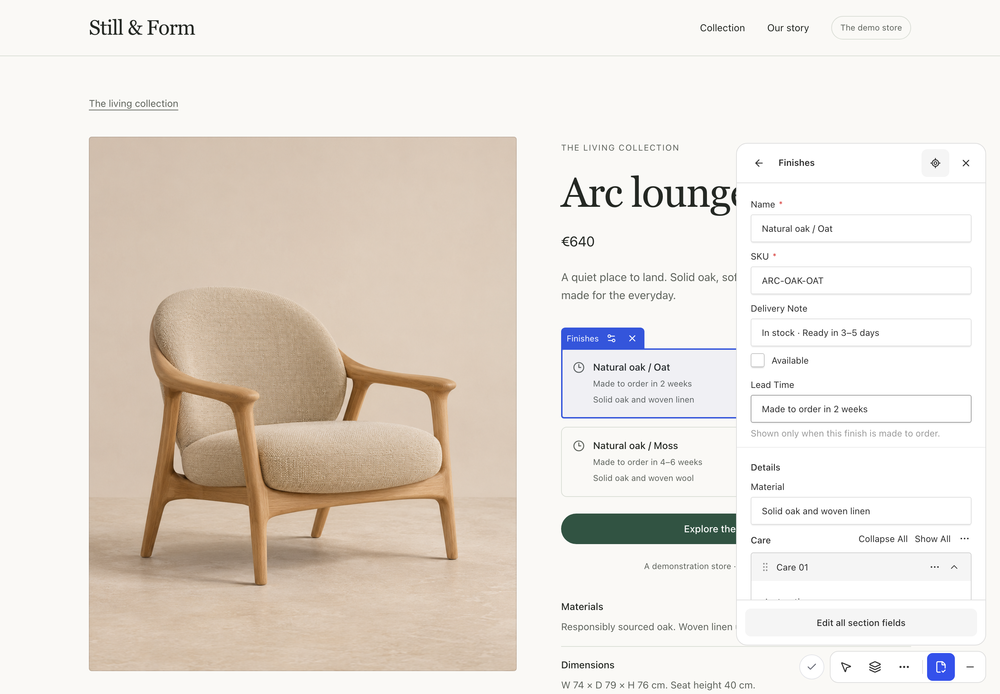
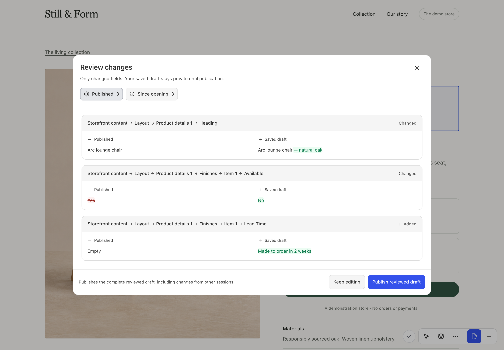

<p align="center">
  
</p>

<h1 align="center">Payload Inplace</h1>

<p align="center">
  Edit the website, right where the content lives.<br>
  Inline text, native Payload fields and reviewed drafts on your existing frontend.
</p>

<p align="center">
  <a href="https://www.npmjs.com/package/payload-inplace"></a>
  <a href="https://github.com/MiguelFranken/payload-inplace/actions/workflows/validate.yml"></a>
  <a href="https://github.com/MiguelFranken/payload-inplace/blob/main/docs/compatibility.md"></a>
  <a href="https://github.com/MiguelFranken/payload-inplace/blob/main/LICENSE"></a>
</p>

<p align="center">
  <a href="#what-you-get">What you get</a> ·
  <a href="#quick-start">Quick start</a> ·
  <a href="#compatibility">Compatibility</a> ·
  <a href="#documentation">Documentation</a> ·
  <a href="https://github.com/MiguelFranken/payload-inplace/blob/main/CONTRIBUTING.md">Contributing</a>
</p>

## What you get

**Your website is the editing surface.** Keep its URL, header, footer and scroll position. Select a heading and type; use native Payload fields when the content needs more than inline text.

- **Inline text and rich text** with native field ownership, preserved styling and compact formatting controls.
- **Media replacement and scoped settings** for images, relationships, conditional fields and nested array items.
- **Sections in context:** one insertion point between blocks, searchable previews, drag-and-drop and keyboard reordering.
- **Immediate feedback, reviewed publishing:** optimistic rendering, debounced draft saves, changed-only comparisons and saved versions.
- **Your schemas and rules:** explicit bindings, existing Payload permissions/hooks and optional app-owned controls.


_Real, synthetic commerce demo. Your application supplies the design; Payload Inplace supplies the editing layer. Open any image for its full-resolution capture._

## See it in action

### Replace media without leaving the page


Replace a document's image reference without rewriting shared asset metadata. [Register the media picker →](https://github.com/MiguelFranken/payload-inplace/blob/main/docs/guides/media.md)

### Keep complex fields native



Select exactly one array item or a related group of fields. Payload retains conditions, validation and access. [Map nested fields →](https://github.com/MiguelFranken/payload-inplace/blob/main/docs/nested-bindings.md)

### Add and organize sections


Preview an option before inserting it. Cancel without saving; insert with native defaults. [Configure sections and previews →](https://github.com/MiguelFranken/payload-inplace/blob/main/docs/guides/sections.md)

### Review what changed



Compare against the published document or the draft at session start. Publish the reviewed saved revision, then return to the website. [Drafts, review and history →](https://github.com/MiguelFranken/payload-inplace/blob/main/docs/guides/publishing.md)

<details>
<summary>See the storefront without editing controls</summary>


The demo includes native `shops` and `products` schemas, a named-tab blocks root, price groups, media, conditional finishes and two nested arrays. [Schema and renderer](https://github.com/MiguelFranken/payload-inplace/tree/main/apps/demo/commerce) · [Run locally](https://github.com/MiguelFranken/payload-inplace/blob/main/CONTRIBUTING.md#run-the-demo)

</details>

## Quick start

Target: **Payload 3.91.0 + Next.js 16.4.2 App Router / Turbopack, React 19.2.x, Node 24+**. This is an integration into your existing website, not an automatic page builder. You do not need Tailwind in your host to consume the package.

```sh
pnpm add payload-inplace @payloadcms/richtext-lexical@3.91.0
```

Configure an existing draft-enabled blocks root:

```ts
import { visualEditor } from "payload-inplace";
import { postgresConcurrency } from "payload-inplace/postgres";
import { canEditWebsite } from "./access/canEditWebsite";

const editor = visualEditor({
  collections: { pages: { roots: ["layout"] } },
  previewOrigin: process.env.SITE_ORIGIN!,
  resolvePagePath: ({ document }) =>
    document.slug === "home" ? "/" : `/${document.slug}`,
  canEdit: ({ req, document }) => canEditWebsite(req.user, document),
  concurrency: postgresConcurrency(),
});

// Add editor to your existing buildConfig({ plugins: [...] }).
```

`canEditWebsite` is your server-side policy, additional to Payload access. Apply the additive revision-field migration through your normal Payload workflow before serving the Postgres guard.

Bind the element that renders the field:

```tsx
import { getBlockAttributes, getFieldAttributes } from 'payload-inplace/bindings'

const identity = { root: 'layout', blockId: block.id }

<section {...getBlockAttributes(identity, active)}>
  <h1 {...getFieldAttributes({ ...identity, field: 'heading', edit: 'inline' }, active)}>
    {block.heading}
  </h1>
</section>
```

`active` comes from your authorized render entry. Helpers are inert when inactive. Connect the server launcher, shared layout, internal active route, dedicated component map and native server-function bridge using the **[step-by-step getting-started guide](https://github.com/MiguelFranken/payload-inplace/blob/main/docs/getting-started.md)**. Every step names the host file, an executable reference and a check.

## Documentation

**[Documentation index →](https://github.com/MiguelFranken/payload-inplace/blob/main/docs/README.md)**

| I want to…                         | Guide                                                                                                                 |
| ---------------------------------- | --------------------------------------------------------------------------------------------------------------------- |
| Get a working integration          | [Getting started](https://github.com/MiguelFranken/payload-inplace/blob/main/docs/getting-started.md)                 |
| Understand the editing flow        | [Screenshot tour](https://github.com/MiguelFranken/payload-inplace/blob/main/docs/tour.md)                            |
| Select every nested element        | [Bindings and terminal fields](https://github.com/MiguelFranken/payload-inplace/blob/main/docs/nested-bindings.md)    |
| Edit native Lexical content inline | [Rich text and styling](https://github.com/MiguelFranken/payload-inplace/blob/main/docs/guides/rich-text.md)          |
| Use the image library              | [Media selection](https://github.com/MiguelFranken/payload-inplace/blob/main/docs/guides/media.md)                    |
| Configure section hover previews   | [Sections and catalogue](https://github.com/MiguelFranken/payload-inplace/blob/main/docs/guides/sections.md)          |
| Customize tools or theme           | [Controls and CSS variables](https://github.com/MiguelFranken/payload-inplace/blob/main/docs/guides/customization.md) |
| Understand saving and publication  | [Drafts and review](https://github.com/MiguelFranken/payload-inplace/blob/main/docs/guides/publishing.md)             |
| Fix an integration problem         | [Troubleshooting](https://github.com/MiguelFranken/payload-inplace/blob/main/docs/troubleshooting.md)                 |

Developer references: [Host runtime contract](https://github.com/MiguelFranken/payload-inplace/blob/main/docs/integration.md) · [Public API](https://github.com/MiguelFranken/payload-inplace/blob/main/docs/api-reference.md) · [Architecture](https://github.com/MiguelFranken/payload-inplace/blob/main/docs/architecture.md) · [Security/caching](https://github.com/MiguelFranken/payload-inplace/blob/main/docs/guides/security.md) · [Test kit](https://github.com/MiguelFranken/payload-inplace/blob/main/docs/testing-and-extensions.md) · [Release/upgrade](https://github.com/MiguelFranken/payload-inplace/blob/main/docs/release.md) · [Contributing](https://github.com/MiguelFranken/payload-inplace/blob/main/CONTRIBUTING.md).

## Compatibility

| Runtime                                        | Tested contract                                                           |
| ---------------------------------------------- | ------------------------------------------------------------------------- |
| Payload / UI / Payload Next / database adapter | **3.91.0**, aligned exact versions                                        |
| Next.js                                        | **16.4.2**, App Router, Turbopack                                         |
| React / React DOM                              | **19.2.x**                                                                |
| Node.js                                        | **24+**, release CI on Node 24                                            |
| Database                                       | Postgres for transactional concurrency; Mongo single-writer demo fallback |

Draft globals, finite document scopes and content localization are opt-in. Cross-origin frontends and editing custom Lexical node internals are outside the current contract. The native bridge is version-pinned; [check compatibility](https://github.com/MiguelFranken/payload-inplace/blob/main/docs/compatibility.md) before upgrading peers.

## License

[MIT](https://github.com/MiguelFranken/payload-inplace/blob/main/LICENSE). Independent of Payload CMS. [Upstream attribution](https://github.com/MiguelFranken/payload-inplace/blob/main/NOTICE).
