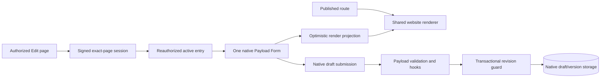

# How the editor fits into your website

The host owns content schemas, renderer, routing, authorization and business rules. Payload Inplace owns reusable authoring behavior around them. Explicit bindings join rendered nodes to existing fields; no second page-tree model is installed.

The proxy is a routing hint, not the authority. Protected renders and server functions recheck the current session and capability. Published caches never contain draft reads. [Security and caching](guides/security.md).

## Field and presentation ownership

A selected field has exactly one owner: browser plaintext, compatible inline Lexical, custom strategy or native control. Opening native settings transfers ownership without discarding the existing value. Native `useField`/Form still own structured data, conditions, validation and saving. Local Suspense boundaries prevent a lazy control from reinitializing the whole Form.

`useEditorPreviewData` derives display from that Form. An acknowledged server read can refresh server-only slots without replacing the Form or accepting stale content over later input. A hover example is a transient display delta, not a native field mutation.

## Design decisions

- [Same-page routing](adr/0006-same-page-editing.md) explains why the public and active routes compile separately and how activation preserves the page URL and layout.
- [Concurrent writes](adr/0002-concurrent-writes.md) explains why the native Postgres operation locks before checking the revision and why autosave version IDs alone are insufficient.
- [Inline rich text](adr/0008-inline-rich-text.md) explains ownership of the temporary editing DOM and the native fallback for custom fields and unsupported content.

The toolbar and panel chrome use Base UI and prefixed Tailwind without Preflight. Base UI portals stay in the editor shadow root. Native Payload widgets keep their own controls and typography. The editor adapts the pinned peer's responsive styles to the panel width and mirrors only the runtime-generated native rules its shadow root uses. See [native v3 adapters](native-v3-adapters.md).

## Repository boundaries

| Workspace                     | Responsibility                                                                             |
| ----------------------------- | ------------------------------------------------------------------------------------------ |
| `packages/payload-inplace`    | The only public npm package: native v3 adapters, editor orchestration and server contracts |
| `packages/core`               | Private, framework-free identity, policy, bindings, geometry and protocol domains          |
| `packages/lexical`            | Private compatible rich-text runtime, bundled into the public facade                       |
| `packages/ui`                 | Private React views, chrome, localization, and colocated stories                           |
| `apps/storybook`              | UI review with the same prefixed styles and shadow-root portals                            |
| `apps/demo`                   | Synthetic commerce consumer plus regression fixtures                                       |
| `tests`                       | Private acceptance workspace for Playwright, Storybook smoke checks and native integration |
| `fixtures/installed-consumer` | Independent production app installing the exact packed archive                             |

Each workspace declares its runtime and development dependencies. The root keeps repository-wide tooling for lint, formatting, Changesets, Turbo, TypeScript-based source checks and aggregate Vitest coverage. The demo owns its Next and Payload runtime, the plugin owns its bundler and CSS build, and the acceptance workspace owns its browser and database test tools.

Consumers install `payload-inplace` and its host peers. The private UI workspace is compiled into the public package. Public subpaths are the supported facade; emitted internals/private workspaces are not API. Turbo caches deterministic build/unit work, while browser/database/artifact gates remain uncached. [Native adapter inventory](native-v3-adapters.md) · [Quality gates](implementation/quality-gates.md).
