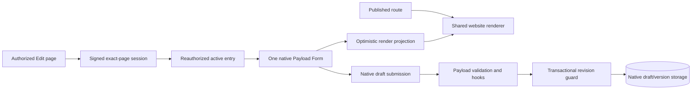

# How the editor fits into your website

The host owns content schemas, renderer, routing, authorization and business rules. Payload Inplace owns reusable authoring behavior around them. Explicit bindings join rendered nodes to existing fields; no second page-tree model is installed.

The proxy is a routing hint, not the authority. Protected renders and server functions recheck the current session and capability. Published caches never contain draft reads. [Security and caching](guides/security.md).

## Field and presentation ownership

A selected field has exactly one owner: browser plaintext, compatible inline Lexical, custom strategy or native control. Opening native settings transfers ownership without discarding the existing value. Native `useField`/Form still own structured data, conditions, validation and saving. Local Suspense boundaries prevent a lazy control from reinitializing the whole Form.

`useEditorPreviewData` derives display from that Form. An acknowledged server read can refresh server-only slots without replacing the Form or accepting stale content over later input. A hover example is a transient display delta, not a native field mutation. [Optimistic ownership](adr/0003-native-optimistic-preview.md).

## Repository boundaries

| Workspace                     | Responsibility                                                                    |
| ----------------------------- | --------------------------------------------------------------------------------- |
| `packages/payload-inplace`    | The only public npm package: native v3 adapters, editor UI and server contracts   |
| `packages/core`               | Private, framework-free identity, policy, bindings, geometry and protocol domains |
| `packages/lexical`            | Private compatible rich-text runtime, bundled into the public facade              |
| `apps/demo`                   | Synthetic commerce consumer plus regression fixtures                              |
| `fixtures/installed-consumer` | Independent production app installing the exact packed archive                    |

Consumers install only `payload-inplace`. Public subpaths are the supported facade; emitted internals/private workspaces are not API. Turbo caches deterministic build/unit work, while browser/database/artifact gates remain uncached. [Workspace ADR](adr/0007-workspace-and-native-boundaries.md) · [Native adapter inventory](native-v3-adapters.md) · [Quality gates](implementation/quality-gates.md).
