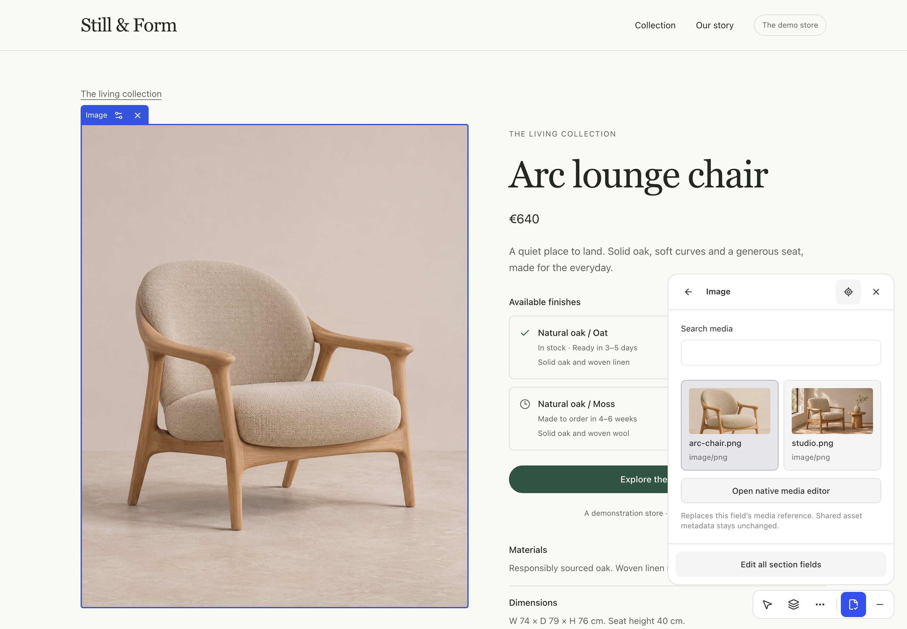

# Add the contextual image picker

The contextual picker opens when you select a bound image. It shows the current image and lets you search for a replacement.



Opt into the picker with an active import-map strategy provider.

```tsx
// components/MediaStrategies.tsx
"use client";
import {
  createPayloadMediaLibrary,
  defineMediaFieldStrategy,
  EditorFieldStrategy,
} from "payload-inplace/frontend";

const media = defineMediaFieldStrategy(
  createPayloadMediaLibrary({ collection: "media", apiPath: "/api" }),
);

export function MediaStrategies() {
  return <EditorFieldStrategy definition={media} />;
}
```

Add to your existing plugin options:

```ts
strategyProviders: [
  { id: 'media', Component: './components/MediaStrategies#MediaStrategies' },
],
```

The path resolves through your Payload import-map base directory. Regenerate **both** admin and dedicated frontend maps, then restart/rebuild. Definitions stay at module scope, not recreated on every render. The [demo provider](../../apps/demo/components/CommerceStrategies.tsx) also demonstrates an optional custom select control.

Bind the single media field to the image wrapper:

```tsx
<div {...getFieldAttributes({ ...identity, field: "image" }, active)}>
  <YourImage media={block.image} />
</div>
```

Omit `edit: 'panel'` here: that explicitly requests native UI and takes precedence over the contextual picker. Multiple-field image/caption groups and has-many media fields use native settings. Supported single/polymorphic references preserve native ID shapes; URLs are not IDs.

Search uses the current user's same-origin native media API and supports debounced, cancellable pagination. Selecting a result changes only this document's reference; shared media metadata remains unchanged. The built-in adapter delegates uploads and shared asset editing to native controls. Your optimistic renderer must resolve a newly selected ID and must not keep showing the old image while loading it.

Need another library? Implement the typed `MediaLibraryAdapter` with authorized search and optional upload/progress. Handle abort/revocation, return collection/ID references and keep asset writes separate from document draft saves. See [adapter details](../implementation/media.md), [public API](../api-reference.md) and [native field fallback](../frontend-component-map.md).

## Try a consumer-owned upload

From the repository root, run `corepack pnpm build` and start the demo with
`VE_DEMO_MEDIA_UPLOAD=1 corepack pnpm dev`. Use a disposable demo instance.

1. Sign in as `admin@example.test`, open [the storefront](http://127.0.0.1:3127/shop)
   and choose **Edit page**. Select the hero image, then **Upload media**. Use
   a synthetic image such as
   [studio.png](../../apps/demo/commerce/assets/studio.png). Wait for **Draft
   saved**. The upload creates a media asset and the draft records its ID in
   the selected image field.
2. Sign in as `editor@example.test` and try uploading again. The opt-in demo
   lets this role edit the page and choose media while Payload denies media
   creation. The upload error offers **Open native media editor**.
3. Open the native editor, remove the current reference, and use **Choose
   from existing** to pick an asset. This replaces the draft's selected
   reference through the native form.

Use the synthetic password from [the demo setup](../../CONTRIBUTING.md#run-the-demo).
The [client adapter](../../apps/demo/commerce/upload-demo-media.ts) reports
transfer progress and aborts when the picker closes. The
[upload route](<../../apps/demo/app/(payload)/api/demo-media-upload/route.ts>)
delegates to Payload's native authenticated create handler. The demo flag
enables the route, strategy, and sample ACL. Leave it unset to use the native
media picker without the additional upload entry point.
