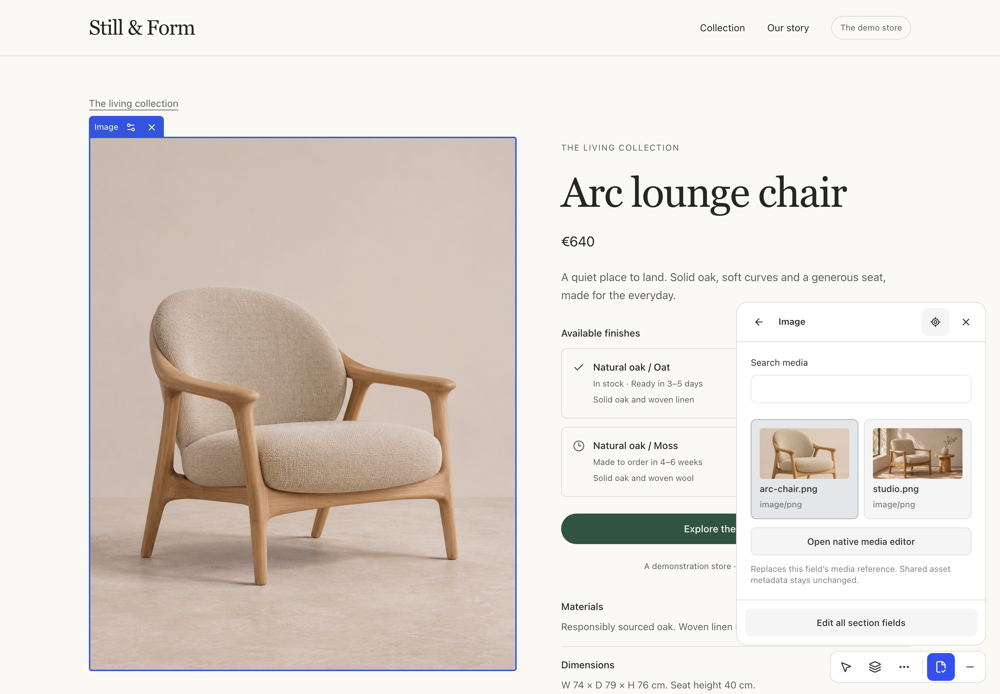

# Add the contextual image picker

The contextual picker opens when you select a bound image. It shows the current image and lets you search for a replacement.



Opt into the picker with an active import-map strategy provider.

```tsx
// components/MediaStrategies.tsx
"use client";
import {
  createPayloadMediaLibrary,
  defineMediaFieldStrategy,
  EditorFieldStrategy,
} from "payload-inplace/frontend";

const media = defineMediaFieldStrategy(
  createPayloadMediaLibrary({ collection: "media", apiPath: "/api" }),
);

export function MediaStrategies() {
  return <EditorFieldStrategy definition={media} />;
}
```

Add to your existing plugin options:

```ts
strategyProviders: [
  { id: 'media', Component: './components/MediaStrategies#MediaStrategies' },
],
```

The path resolves through your Payload import-map base directory. Regenerate **both** admin and dedicated frontend maps, then restart/rebuild. Definitions stay at module scope, not recreated on every render. The [demo provider](../../apps/demo/components/CommerceStrategies.tsx) also demonstrates an optional custom select control.

Bind the single media field to the image wrapper:

```tsx
<div {...getFieldAttributes({ ...identity, field: "image" }, active)}>
  <YourImage media={block.image} />
</div>
```

Omit `edit: 'panel'` here: that explicitly requests native UI and takes precedence over the contextual picker. Multiple-field image/caption groups and has-many media fields use native settings. Supported single/polymorphic references preserve native ID shapes; URLs are not IDs.

Search uses the current user's same-origin native media API and supports debounced, cancellable pagination. Selecting a result changes only this document's reference; shared media metadata remains unchanged. The built-in adapter delegates uploads and shared asset editing to native controls. Your optimistic renderer must resolve a newly selected ID and must not keep showing the old image while loading it.

Need another library? Implement the typed `MediaLibraryAdapter` with authorized search and optional upload/progress. Handle abort/revocation, return collection/ID references and keep asset writes separate from document draft saves. See [adapter details](../implementation/media.md), [public API](../api-reference.md) and [native field fallback](../frontend-component-map.md).
