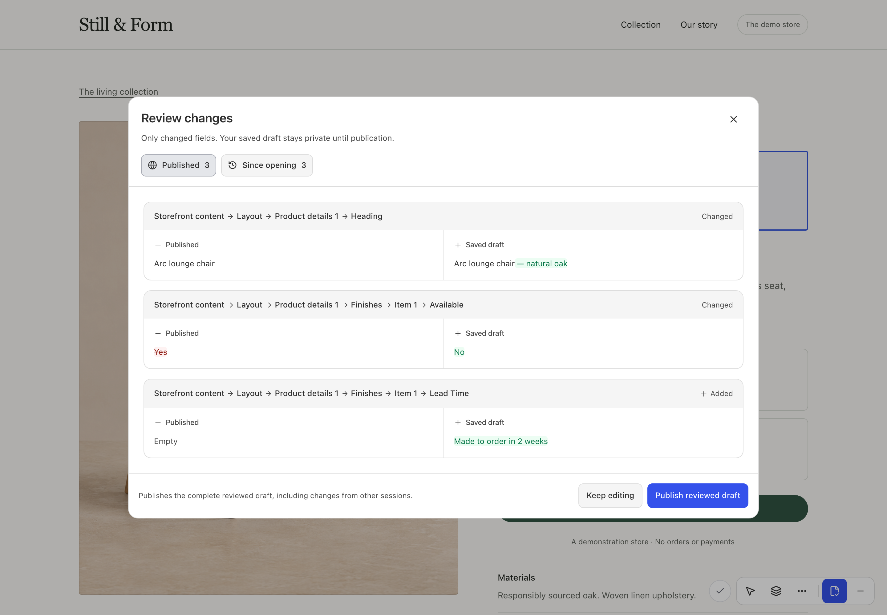

# Drafts, review and publication

Inline input changes the native Form immediately. The optimistic renderer reflects those values while the existing native submission path saves after an idle pause. Short bursts are batched; a save acknowledgment confirms only its submitted snapshot, so later typing stays protected.

Drafts are **shared Payload drafts**, not private per-editor branches. Another authorized editor or the native admin can change the same document. Postgres revision guards reject stale writes, and optional native advisory locks pause a foreign user's active session. See [conflicts and locks](../implementation/conflicts-and-locks.md).

## Compare sections on the page

After the draft saves, choose **More tools → Compare sections**. Use **Sections** for a page overview and **Elements** to outline changed fields that render in the selected version. Switch between **Draft** and **Published** to see how the saved content looks in context. [See the comparison controls in the tour](../tour.md#compare-sections-on-the-page) · [Set up the preview renderer](../integration.md#compare-sections-on-the-page)

## Review before publishing

Open **Review changes** from the toolbar. Compare the saved draft with **Published** or use **Since opening** to compare it with the draft at the start of the session. The review lists changed fields, and section moves, additions, and removals follow stable row identities.

Text can retain shared wording while highlighting the edit. Checkboxes, numbers, dates, choices, and references are shown as whole values. Formatting-only rich-text changes are called out when the visible text stays the same.

The server signs the saved revision/content under current access. Publication must match that review; subsequent edits or another writer require a fresh review. Saving a draft does not publish it. Once reviewed publication succeeds, authoring closes and the same website returns to published mode; reopen Edit page to start again. Failed publication retains the editor and working copy.

## Browse saved versions

More tools opens saved versions with paginated metadata and changed-only comparison. Restore creates a **new draft** from a server-reloaded native version; it does not publish, rewind revision metadata or accept client snapshots as authority. Clear pending local changes before restoring. [Version/restore contract](../implementation/versions.md).

## Recover deliberately

On a failed save, keep the working copy, correct native validation or retry explicitly. A stale revision requires comparison/reconciliation. Revoked access freezes edits and offers the existing recovery/download path; it never bypasses authorization. Do not add an independent fetch/autosave loop around the plugin. Uploading a media asset is a separate write even if the page draft has not been published.

For multiple records, review/publication apply to the selected document only. [Finite document scopes](../implementation/document-scopes.md) do not imply atomic publication of a page plus header/footer.
