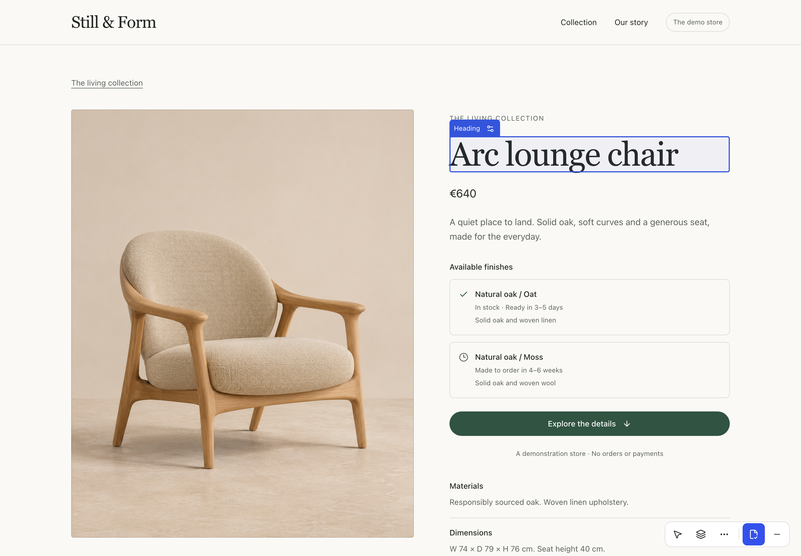
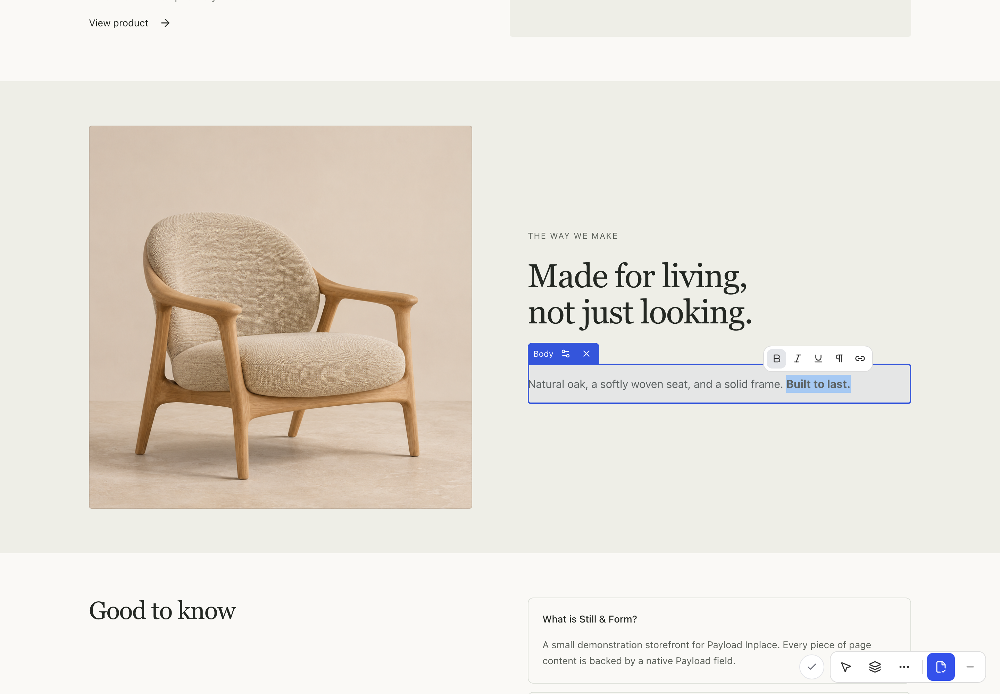
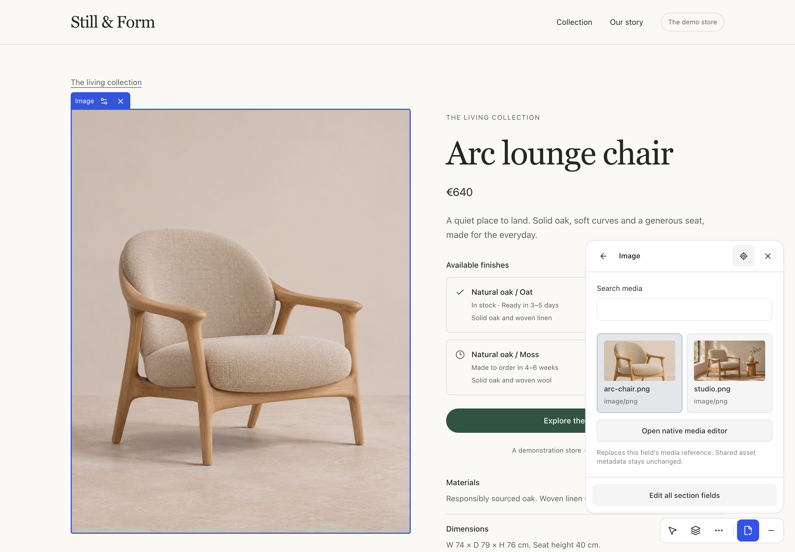
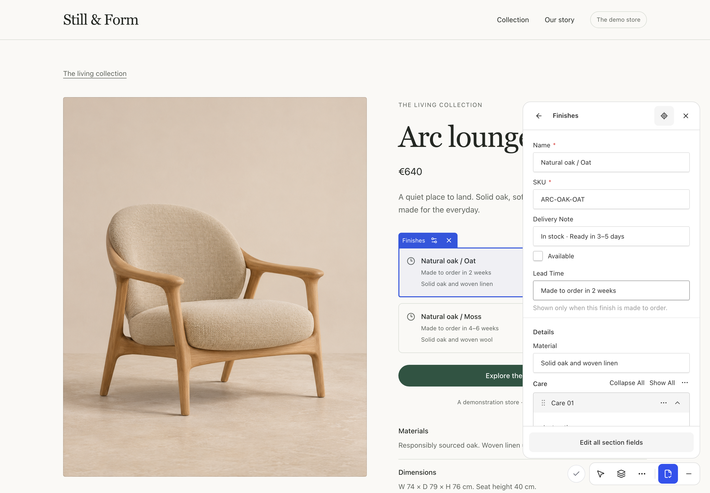
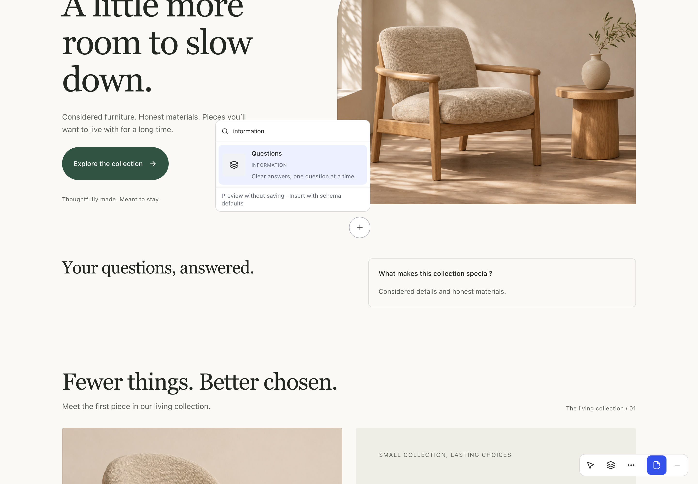
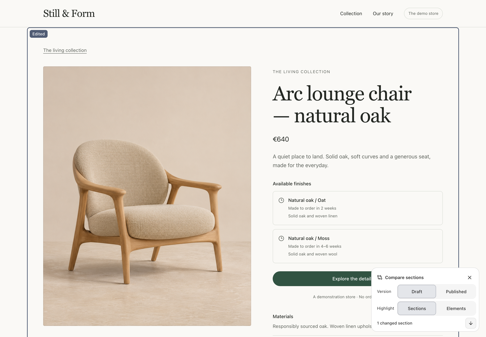
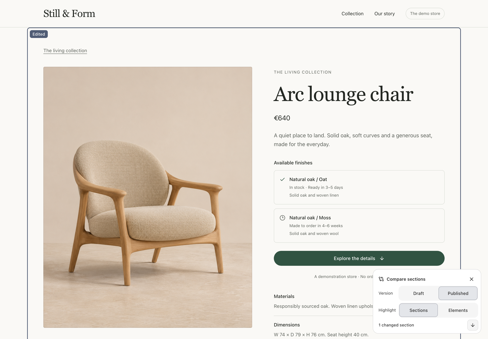
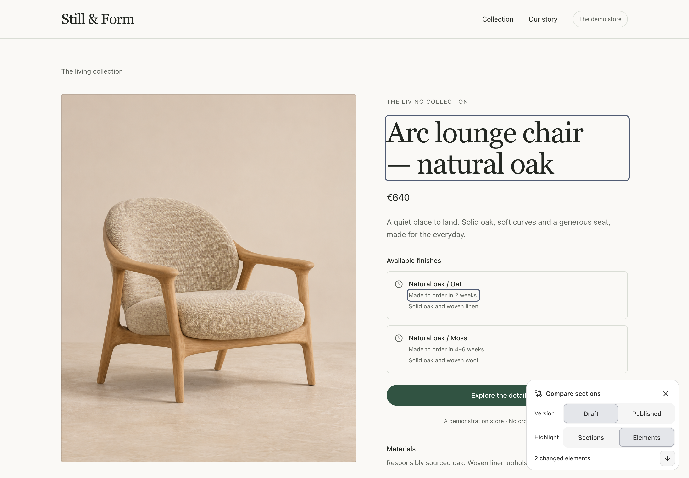
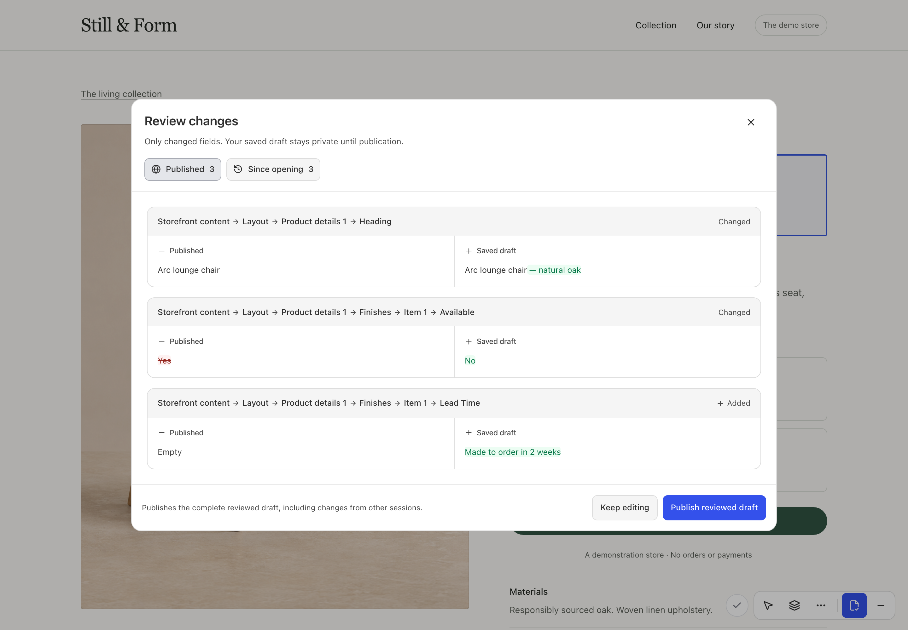
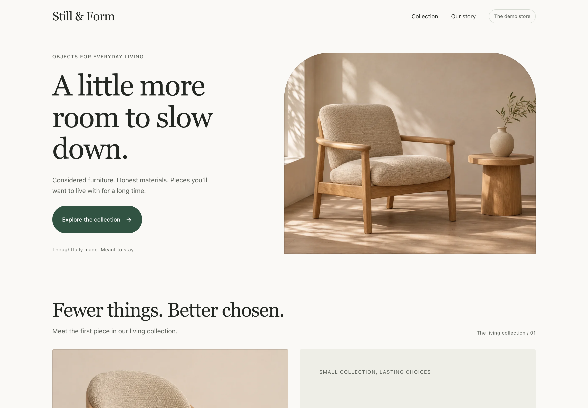

# A tour of the editor

These browser captures come from the Still & Form demo, which uses native Payload schemas and synthetic content. The demo footer links to the test login. Sign in, return to the page, and press the edit icon. [Run the demo](../CONTRIBUTING.md#run-the-demo)

## Write directly on the website

Select a heading or paragraph and type. Turn on hover highlighting to find editable fields, or select a field directly. Use the settings icon in the selection caption to open native fields. [Bind rendered fields](nested-bindings.md)

Select part of a rich-text paragraph to see its active formatting in the toolbar. The text keeps the typography and layout of the site while you edit. [Set up inline rich text](guides/rich-text.md)

## Choose media visually

The optional library replaces one native reference. It is reusable in your host, not specific to the demo. [Media setup](guides/media.md).

## Open exactly the fields you need

This finish is one row inside the product's array. Its SKU, native checkbox and conditional lead time remain native controls. Resize the panel; the website keeps its own layout. [Nested arrays](nested-bindings.md) · [Customization](guides/customization.md).

## Preview and insert a section

Hover or focus an option to preview it where the plus was opened. Closing cancels it without a save; insertion uses native defaults. Use the section list for locate, settings and pointer/keyboard reordering. [Catalogue configuration](guides/sections.md).

## Compare sections on the page

Open **More tools → Compare sections** once the draft has saved. The outline and **Edited** marker identify the product section containing changes. Switch between **Draft** and **Published** to compare the heading on the same page.

See the same section in Published view

Choose **Elements** to outline the changed heading and delivery estimate directly. The next-change button follows the chosen highlight mode. Switching views leaves the saved draft intact. [Enable on-page comparison](integration.md#compare-sections-on-the-page)

## Review the saved draft

**Review changes** shows the exact fields that differ from the published document or the draft when you opened the editor. The heading highlights the added words, while availability shows the complete **Yes** and **No** values. Publishing the reviewed draft closes editing. [Publishing and saved versions](guides/publishing.md)

## Your existing website stays yours

Your app owns schemas and design. The demo's [commerce renderer](../apps/demo/commerce/CommercePageView.tsx) is shared by public and active entries. [Screenshot provenance and dimensions](images/README.md).
