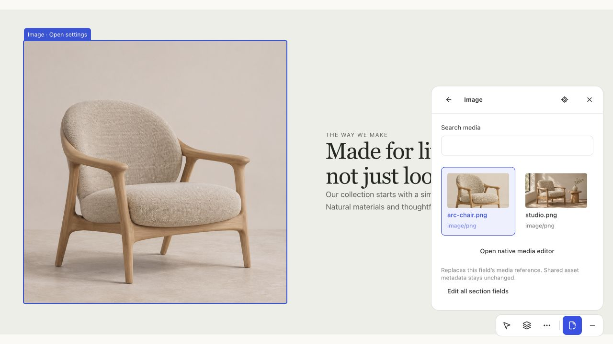
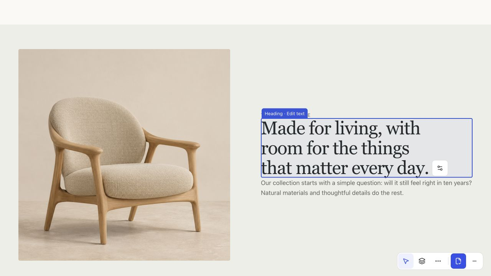
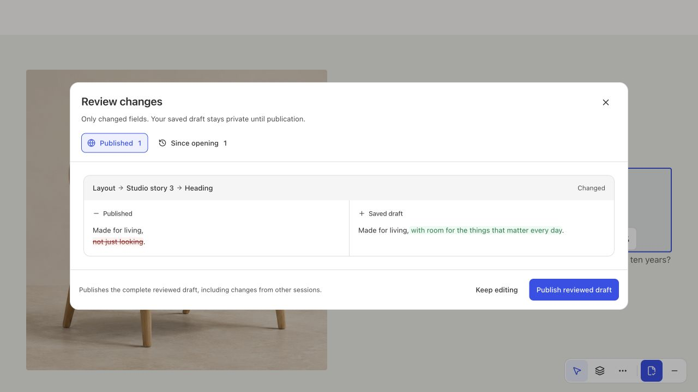

# Selection, persistence feedback and terminal publication

The selected outline was discarded when a native settings panel opened. It now remains attached to that selected target until selection changes or settings close. Geometry previously observed only the page body; a leaf can reflow inside a fixed-height grid without changing the body. The observer now follows the actual selected/hovered leaf or temporary Lexical surface and coalesces inline geometry events through requestAnimationFrame.

The dock uses 2px padding around 40px controls: its measured size is 225 × 46px. Actual queue activity drives an independent left-side feedback bubble. It retains one spinner across queued saves, shows acknowledgment for two seconds, then fades and translates under the dock. Initial clean documents have no visual checkmark. A persistent screen-reader status remains available.

Review is always the configured toolbar action. It no longer switches to Payload's native direct-publish control when native document metadata omits the optional revision field. Configured roots are available with or without the transactional adapter. Successful reviewed publication uses the existing exact-page deactivation and router transition; failed native submission keeps the working editor and its existing recovery queue. The native admin document view remains open after publication.

Canvas insertion shows one nearest permitted gap, with one 44px round affordance. Its lazy placeholder and loaded catalogue use identical geometry. It preserves adjacent stable identity while the picker is open.

## Focused validation

- TypeScript, ESLint, oxlint, source boundaries, API-doc parity and 229 domain/component tests pass.
- Ten affected production browser scenarios were checked across focused runs: media selection and review; growing/shrinking plaintext and rich text; failed publication recovery and successful same-page exit/re-entry; commerce terminal saving/publication; collection and nested-root publication; accessible changed-only review; exact gap cancellation; related-document publication/session cleanup; native text undo and structural history.
- The publication case asserts the original document/header/footer objects and URL survive a successful exit. A simulated 503 retains the editor, re-saves the draft through explicit recovery, obtains a fresh signed review, then publishes.
- The nontransactional Mongo review/toolbar case is a separate CI gate, alongside the existing PostgreSQL validation. This does not grant Mongo atomic multi-writer guarantees.
- Codex browser visually inspected persistent image selection, wrapped inline text and closing/reopening changed-only review on the running demo.
- Next's output-directory-specific `next-env.d.ts` is generated rather than tracked, so test builds do not invalidate the immutable package's clean-source receipt.

These are local checks. Publication and real Workshops acceptance are recorded separately in `workshops-release.json`.

